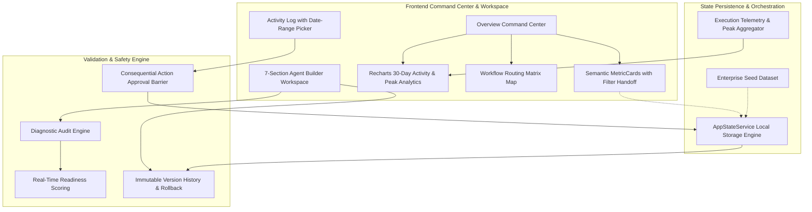

<div align="center">

# ⚡ CORE Agents

### Enterprise-Grade AI Workforce Architecture & Orchestration Platform

*Design, audit, simulate, and govern autonomous specialist AI agents with strict bounding, deterministic review gates, and real-time operational telemetry.*

<br/>

[](https://coreagents-one.vercel.app/)
[](https://github.com/garvshaw89-glitch/core_agents)
[](https://coreagents-one.vercel.app/)

<br/>

[](https://react.dev/)
[](https://www.typescriptlang.org/)
[](https://vitejs.dev/)
[](https://tailwindcss.com/)
[](https://recharts.org/)
[](https://github.com/google-gemini/generative-ai-js)
[](https://motion.dev/)
[](LICENSE)

</div>

---

## 📑 Table of Contents

- [Executive Overview](#-executive-overview)
- [Why CORE Agents?](#-why-core-agents)
- [System Architecture](#-system-architecture)
- [Core Platform Capabilities](#-core-platform-capabilities)
  - [1. AI Workflow Command Center](#1-ai-workflow-command-center)
  - [2. 30-Day Activity Volume & Peak Usage Analytics](#2-30-day-activity-volume--peak-usage-analytics)
  - [3. Advanced 7-Section Agent Builder Workspace](#3-advanced-7-section-agent-builder-workspace)
  - [4. Diagnostic Audit & Readiness Engine](#4-diagnostic-audit--readiness-engine)
  - [5. Immutable Version History & Visual Diff Engine](#5-immutable-version-history--visual-diff-engine)
  - [6. Activity Feed with Date-Range & Type Filtering](#6-activity-feed-with-date-range--type-filtering)
  - [7. Deterministic Multi-Stage Workflows & Approval Gates](#7-deterministic-multi-stage-workflows--approval-gates)
  - [8. Knowledge Ingestion & Integrations Hub](#8-knowledge-ingestion--integrations-hub)
- [Tech Stack](#-tech-stack)
- [Directory Structure](#-directory-structure)
- [Getting Started](#-getting-started)
  - [Prerequisites](#prerequisites)
  - [Installation](#installation)
  - [Development Server](#development-server)
  - [Production Build & Linting](#production-build--linting)
- [Environment Configuration](#-environment-configuration)
- [Design Tokens & UI Constitution](#-design-tokens--ui-constitution)
- [Deployment on Vercel](#-deployment-on-vercel)
- [Contributing](#-contributing)
- [License](#-license)

---

## 🔭 Executive Overview

**CORE Agents** is an enterprise-grade AI workforce architecture platform built for developers, engineering managers, and technical operators who require reliability beyond unpredictable conversational prompt boxes. 

Instead of treating AI as an unstructured chat window, CORE Agents models autonomous capabilities as **specialized, bounded workers** with:
- Formal tool whitelisting and parameter isolation.
- Real-time diagnostic readiness grading before deployment.
- Consequential action barriers that halt execution for human authorization prior to external writes.
- Continuous 30-day telemetry monitoring with peak usage detection.
- Complete version snapshot histories with instant 1-click rollback capabilities.

---

## ⚖️ Why CORE Agents?

| Operational Challenge | Generic AI Chatboxes / Raw APIs | The CORE Agents Paradigm |
| :--- | :--- | :--- |
| **Prompt Engineering** | Unstructured monolithic string mixing goals, tone, and schemas. | **Modular 5-Part Schema:** Role, Objectives, Procedures, Prohibitions, and Output Format. |
| **Deployment Readiness** | Blind assumptions; silent failures during production dispatch. | **Diagnostic Audit Engine:** Real-time readiness scoring with zero-click remediation. |
| **Change Control** | Ephemeral edits; loss of historical prompt tuning. | **Immutable JSON Snapshots:** Automatic versioning with semantic diffs and 1-click revert. |
| **Consequential Risk** | Agents can execute irreversible destructive API calls. | **Review Gates:** Execution halts at authorization checkpoints for human sign-off. |
| **Capacity Management** | Zero visibility into workload distribution or rate limits. | **Recharts 30-Day Telemetry:** Peak usage detection and 24-hour UTC histogram distribution. |

---

## 🏛️ System Architecture



---

## 🚀 Core Platform Capabilities

### 1. AI Workflow Command Center
- **Dedicated Semantic MetricCards**: Interactive KPI cards (`Total Agents`, `Active Specialists`, `Active Pipelines`, `Approval Gate`) that accept typed statuses (`active`, `success`, `warning`, `info`) and provide keyboard-accessible navigation into filtered application views.
- **Interactive Routing Pipeline Matrix**: Visualizes the 5-stage deterministic execution lifecycle (`Intake` → `Classify` → `Human Review Gate` → `Fallback Routing` → `Deliver Output`) with active latency, throughput, and error metrics.
- **Honest Zero-State Toggle**: Header toggle allowing developers to instantly test clean empty states vs. populated enterprise datasets.

### 2. 30-Day Activity Volume & Peak Usage Analytics
- **Recharts Data Visualization**: Interactive time-series showing daily run rates over the past 30 days.
- **Peak Hour Detection**: 24-hour UTC distribution histogram pinpointing enterprise peak windows (**14:00 – 17:00 UTC**) and capacity headroom (**01:00 – 06:00 UTC**).
- **Drilldown Controls**: Filter by specific agent specialist, switch between continuous gradient area trends and stacked status bars, and inspect peak day markers.

### 3. Advanced 7-Section Agent Builder Workspace
- **Identity & Blueprinting**: Name, purpose, domain category, dynamic developer icons, and searchable capability tags.
- **Structured Instruction Engineering**: Discrete fields for Role, Objective, Operating Procedures, Strict Prohibitions, and Output Deliverable formatting.
- **Model Hyperparameter Tuning**: Frontier LLM selection (Gemini 2.5 Pro & Flash, Claude 3.7 Sonnet, GPT-4.5) with granular sliders for Temperature, Top-P, and Max Output Tokens.
- **Tool Registry**: Scoped entitlements for file system access, terminal runners, web ingestion, code analysis, and SQL connectors.
- **Knowledge Base Grounding**: Attach indexed project documentation and reference files with real-time token chunk estimation.
- **Interactive Sandbox Simulator**: Step-by-step execution simulation illustrating vector search, model reasoning, and human approval barriers.

### 4. Diagnostic Audit & Readiness Engine
- Continuously parses agent configuration in real-time.
- Flags blocking **Errors** (missing name, unconfigured instructions), **Warnings** (missing tools, absent safety boundaries), and **Optimization Opportunities**.
- Provides **1-Click Remediation**: Click any diagnostic finding to automatically navigate to the exact section and focus the input field.

### 5. Immutable Version History & Visual Diff Engine
- Captures frozen JSON snapshots on every manual or automated save.
- Displays semantic revision numbers (`v1`, `v2`, `v3`), authors, and change summaries.
- Computes granular diffs across models, tools, and prompt text.
- Supports **Non-Destructive Rollbacks**: Reverting creates a verifiable recovery checkpoint without data loss.

### 6. Activity Feed with Date-Range & Type Filtering
- **Date-Range Picker**: Filter traces by **All Time**, **Today**, **Yesterday**, **Last 7 Days**, **Last 30 Days**, or **Custom Date Boundaries** (`<input type="date" />`).
- **Activity Type Filter Bar**: Segmented tabs with dynamic counts for `Completed`, `Awaiting Approval`, `Failed`, and `Running`.
- **Specialist Isolation**: Filter logs by specific specialist agent.
- **Cryptographic Trace Inspector**: Slide-over drawer detailing run duration, raw event logs, step-by-step progress, and one-click authorization for paused runs.

### 7. Deterministic Multi-Stage Workflows & Approval Gates
- Connect execution triggers (cron schedules or incoming webhooks) directly to specialized agents.
- Human approval barriers halt execution when consequential actions (e.g. database updates, Slack broadcasts) are detected.

### 8. Knowledge Ingestion & Integrations Hub
- Document parsing with token chunk estimation for bounded retrieval.
- Least-privilege OAuth scopes for GitHub, Slack, Notion, Google Drive, and PostgreSQL.

---

## 🛠️ Tech Stack

| Domain | Technology | Version | Purpose |
| :--- | :--- | :--- | :--- |
| **UI Framework** | [React](https://react.dev/) | `^19.0.1` | Concurrent rendering & modern hook architecture |
| **Language** | [TypeScript](https://www.typescriptlang.org/) | `^7.0.2` | Complete end-to-end type safety |
| **Bundler & Tooling** | [Vite](https://vitejs.dev/) | `^8.3.0` | Ultra-fast client builds & ES module resolution |
| **Styling** | [Tailwind CSS](https://tailwindcss.com/) | `^4.3.3` | High-performance CSS via `@tailwindcss/vite` |
| **Charts & Metrics** | [Recharts](https://recharts.org/) | `^2.15.x` | Responsive SVG data visualization |
| **Animation Engine** | [Motion](https://motion.dev/) | `^12.23.24` | GPU-accelerated micro-interactions |
| **Iconography** | [Lucide React](https://lucide.dev/) | `^0.546.0` | Developer icon library |
| **AI SDK** | [@google/genai](https://www.npmjs.com/package/@google/genai) | `^2.4.0` | Google GenAI SDK for Gemini models |
| **Deployment** | [Vercel](https://vercel.com/) | Edge | Production static hosting with SPA rewrites |

---

## 📂 Directory Structure

```text
├── public/                          # Static branding & browser assets
│   ├── favicon.svg                  # High-contrast geometric CORE vector icon
│   ├── favicon.ico                  # Multi-resolution ICO (16x16, 32x32)
│   ├── favicon-16x16.png            # 16x16 browser favicon
│   ├── favicon-32x32.png            # 32x32 browser favicon
│   ├── apple-touch-icon.png         # iOS home screen bookmark icon
│   └── site.webmanifest             # Web application manifest
├── src/
│   ├── main.tsx                     # DOM application root
│   ├── App.tsx                      # Root router, hash navigation & drawer controllers
│   ├── index.css                    # Tailwind CSS v4 directives & theme styles
│   ├── types/
│   │   └── app.ts                   # Domain schemas (Agent, ActivityRecord, Workflow)
│   ├── services/
│   │   ├── appStateService.ts       # LocalStorage persistence, versioning & diff engine
│   │   ├── agentValidationService.ts# Diagnostic audit engine & readiness validator
│   │   └── initialData.ts           # Enterprise seed dataset & historical activity
│   ├── design-system/               # Reusable atomic design system components
│   │   ├── MetricCard.tsx           # Semantic KPI card with status props & navigation
│   │   ├── AgentCard.tsx            # Grid & list views for specialist agents
│   │   ├── ActivityItem.tsx         # Activity row item with status badge
│   │   ├── AmbientBackground.tsx    # Quantum ambient light fields
│   │   ├── Button.tsx               # Styled primary, secondary, outline & ghost buttons
│   │   ├── StatusBadge.tsx          # Zero-pill status indicator with dot
│   │   ├── tokens.ts                # Centralized color tokens & palette values
│   │   └── ...                      # Inputs, dialogs, drawers, and tabs
│   ├── components/
│   │   ├── app/                     # Platform application components
│   │   │   ├── ActivityVolumeChart.tsx # Recharts 30-day activity volume & peak usage
│   │   │   ├── WorkflowRoutingMap.tsx  # Interactive 5-stage orchestration pipeline
│   │   │   ├── AppShell.tsx            # Main enterprise sidebar & top bar layout
│   │   │   ├── ActivityDetailDrawer.tsx# Trace inspection & human approval drawer
│   │   │   └── CreateWorkflowModal.tsx # Automation workflow trigger setup
│   │   └── builder/                 # Specialized Agent Builder workspace modules
│   │       ├── AgentBuilderShell.tsx        # Top bar, section navigation & audit trigger
│   │       ├── AgentVersionHistoryPanel.tsx # Version timeline & 1-click revert drawer
│   │       ├── BuilderInstructionsSection.tsx# 5-part prompt engineering editor
│   │       ├── BuilderModelSection.tsx      # Model selector & parameter sliders
│   │       ├── BuilderToolsSection.tsx      # Tool registry & entitlement toggles
│   │       ├── BuilderTestingSection.tsx    # Interactive sandbox & execution simulator
│   │       └── BuilderValidationPanel.tsx   # Diagnostic readiness checklist
│   └── pages/                       # Primary views
│       ├── OverviewPage.tsx         # AI Workflow Command Center & telemetry
│       ├── MyAgentsPage.tsx         # Filterable specialist agent fleet
│       ├── ActivityPage.tsx         # Activity feed with Date-Range picker & status tabs
│       ├── WorkflowsPage.tsx        # Deterministic multi-stage schedules
│       ├── TemplatesPage.tsx        # Blueprint marketplace
│       ├── KnowledgePage.tsx        # Document store & indexing status
│       ├── IntegrationsPage.tsx     # Authorized developer tools
│       └── SettingsPage.tsx         # Workspace governance & zero-state toggle
├── index.html                       # Entry point with SEO metadata & favicons
├── package.json                     # Dependencies and build scripts
├── tsconfig.json                    # Strict TypeScript configuration
└── vercel.json                      # Vercel SPA routing configuration
```

---

## ⚡ Getting Started

### Prerequisites

- **Node.js:** v18.0.0 or later (Node.js 20+ LTS recommended)
- **Package Manager:** `npm` (v9+) or `pnpm`

### Installation

1. Clone the repository:
   ```bash
   git clone https://github.com/garvshaw89-glitch/core_agents.git
   cd core_agents
   ```

2. Install dependencies:
   ```bash
   npm install
   ```

### Development Server

Start the local development server:
```bash
npm run dev
```

Open [http://localhost:3000](http://localhost:3000) in your browser.

### Production Build & Linting

Validate TypeScript types:
```bash
npm run lint
```

Compile the optimized production bundle:
```bash
npm run build
```

Preview the production build locally:
```bash
npm run preview
```

---

## 🔐 Environment Configuration

Create an environment configuration file:
```bash
cp .env.example .env.local
```

| Variable | Type | Description |
| :--- | :--- | :--- |
| `GEMINI_API_KEY` | Optional | Google Gemini API key used when invoking server-side LLM calls via `@google/genai`. |
| `APP_URL` | Optional | Application base URL (defaults to `http://localhost:3000`). |

> **Security Note:** All agent sandboxing, version history diffing, and execution trace simulations operate client-side using browser storage without leaking sensitive credentials to external servers.

---

## 🎨 Design Tokens & UI Constitution

CORE Agents adheres to an intentional, high-contrast **Cyber Midnight** visual identity:

- **Primary Background:** `#080B16` (Deep Space Midnight)
- **Card Background:** `#0D1220` (Glassmorphic Navy with `border-slate-800/70`)
- **Accent Primary:** `#38D9FF` (Electric Cyan)
- **Status Success:** `#34D399` (Emerald)
- **Review Barrier:** `#FBBF24` (Amber Warning)
- **Failure / Violation:** `#FB7185` (Rose)
- **Pipeline Accent:** `#8B5CF6` (Electric Violet)
- **Typography:** *Plus Jakarta Sans* for headings & body copy; *JetBrains Mono* for tabular telemetry, timestamps, and hashes.
- **Zero-Pill Discipline:** Crisp status indicators and monospace labels rather than rounded pill buttons.

---

## 🚀 Deployment on Vercel

The application is pre-configured for zero-friction deployment on [Vercel](https://vercel.com/) via `vercel.json`:

```json
{
  "$schema": "https://openapi.vercel.sh/vercel.json",
  "framework": "vite",
  "buildCommand": "npm run build",
  "outputDirectory": "dist",
  "rewrites": [
    {
      "source": "/(.*)",
      "destination": "/index.html"
    }
  ]
}
```

1. Push your changes to the `main` branch on GitHub.
2. Connect your repository in the Vercel dashboard.
3. Build command: `npm run build` | Output directory: `dist`.
4. Deploy!

---

## 🤝 Contributing

Contributions, issues, and feature proposals are welcome!

1. Fork the Project.
2. Create your Feature Branch:
   ```bash
   git checkout -b feature/AmazingFeature
   ```
3. Commit your Changes:
   ```bash
   git commit -m "feat: add webhook retry policy configuration"
   ```
4. Verify tests and compilation:
   ```bash
   npm run lint
   npm run build
   ```
5. Push to the Branch:
   ```bash
   git push origin feature/AmazingFeature
   ```
6. Open a Pull Request.

---

## 📄 License

Distributed under the **MIT License**. See `LICENSE` for more information.

<div align="center">
  <sub>Built with engineering excellence for the next generation of autonomous AI workforces.</sub>
</div>
