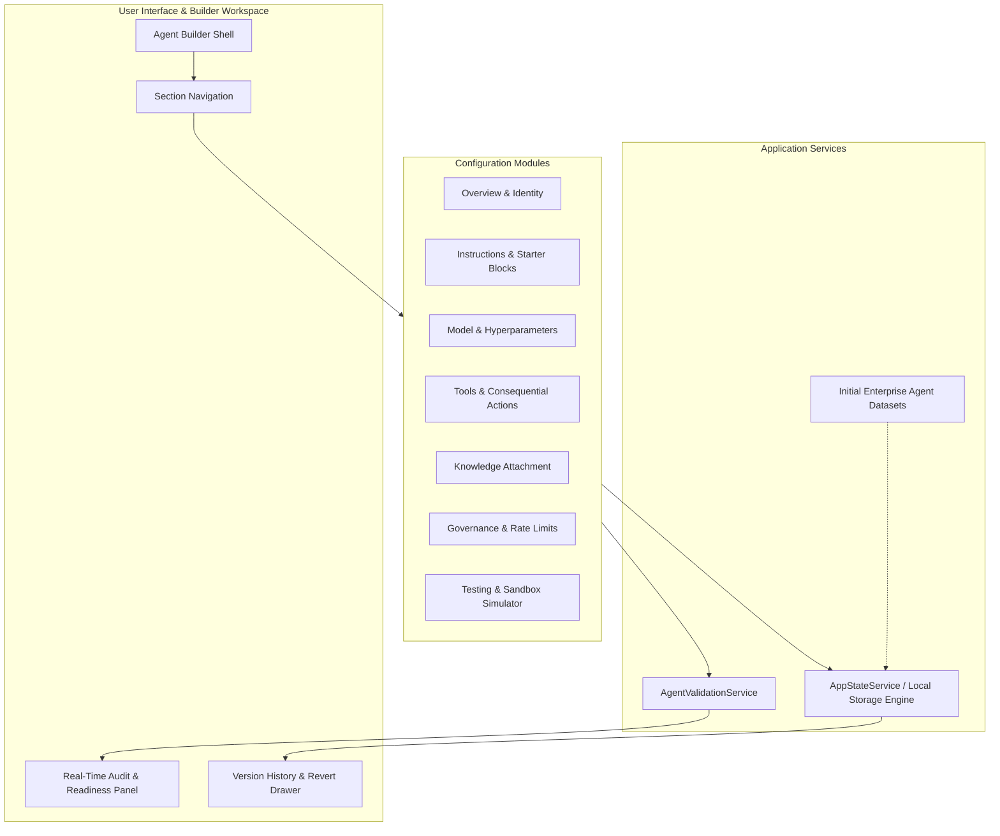

<div align="center">

# CORE Agents

**The Developer-First AI Workforce Platform**

*Discover, configure, audit, and orchestrate specialist AI agents with human-in-the-loop review gates and deterministic sandboxing.*

[](https://coreagents-one.vercel.app/)
[](https://github.com/garvshaw89-glitch/core_agents)

<br/>

[](https://react.dev/)
[](https://www.typescriptlang.org/)
[](https://vitejs.dev/)
[](https://tailwindcss.com/)
[](https://github.com/google-gemini/generative-ai-js)
[](https://vercel.com/)

</div>

---

## Table of Contents

- [Overview](#overview)
- [Architecture](#architecture)
- [Implemented Capabilities](#implemented-capabilities)
  - [1. Agent Template Discovery & Blueprint Marketplace](#1-agent-template-discovery--blueprint-marketplace)
  - [2. Advanced 7-Section Agent Builder](#2-advanced-7-section-agent-builder)
  - [3. Real-Time Diagnostic Audit Engine](#3-real-time-diagnostic-audit-engine)
  - [4. Immutable Version History & Rollback](#4-immutable-version-history--rollback)
  - [5. Interactive Testing Console & Execution Simulator](#5-interactive-testing-console--execution-simulator)
  - [6. Human-in-the-Loop Governance & Review Gates](#6-human-in-the-loop-governance--review-gates)
  - [7. Workflows, Activity Feeds & Integrations](#7-workflows-activity-feeds--integrations)
- [Tech Stack](#tech-stack)
- [Directory Structure](#directory-structure)
- [Getting Started](#getting-started)
  - [Prerequisites](#prerequisites)
  - [Installation](#installation)
  - [Local Development](#local-development)
  - [Production Build](#production-build)
- [Environment Variables](#environment-variables)
- [Data Architecture & Persistence](#data-architecture--persistence)
- [Vercel Deployment](#vercel-deployment)
- [Troubleshooting & FAQs](#troubleshooting--faqs)
- [Roadmap](#roadmap)
- [Contributing](#contributing)
- [License](#license)

---

## Overview

**CORE Agents** is a dark-themed, developer-oriented AI workforce environment designed to move beyond fragile prompt boxes. It provides a structured workspace where teams discover specialist agent templates, construct customized agent personas, manage tool capabilities, attach reference knowledge bases, enforce human-approval gates for consequential actions, and test agent execution traces in a deterministic simulator.

### The Problem It Solves

- **Lack of Structure in Agent Prompts:** Standard chat UIs combine role, objectives, constraints, and output formatting into one brittle string. CORE Agents provides structured input fields with modular starter blocks.
- **Blind Deployments:** Agents often execute without clear capability boundaries. CORE Agents introduces an automated real-time audit engine that grades agent readiness and flags missing configurations.
- **No Revision Tracking:** Prompts and tool parameters are constantly tweaked without change history. CORE Agents captures immutable snapshots on every save, allowing instant rollbacks and visual diffs.
- **Uncontrolled Consequential Actions:** Unregulated tool dispatch can delete databases or trigger unintended API side-effects. CORE Agents enforces an explicit review gate separating autonomous tasks from human-approved operations.

---

## Architecture

CORE Agents operates as a high-performance React SPA built with Vite, Tailwind CSS v4, and TypeScript. All agent definitions, version histories, execution logs, and workflow associations are managed through an extensible state service layer with browser-local persistence.



---

## Implemented Capabilities

### 1. Agent Template Discovery & Blueprint Marketplace
- **Curated Starter Blueprints:** Browse ready-to-run templates categorized across Research, Coding, Operations, Learning, Marketing, and Productivity.
- **Cloned Instance Isolation:** Adopting a marketplace blueprint instantiates an independent user agent copy without mutating the original template.
- **Search & Filter Taxonomy:** Real-time search across agent names, descriptions, categories, and approved toolsets.

### 2. Advanced 7-Section Agent Builder
- **Overview & Identity:** Configure agent name, short description, category assignment, intended operational purpose, dynamic icon picker (10+ developer icons), and tag management.
- **Structured Instruction Editor:** Multi-field prompt engineering separating **Role**, **Primary Objective**, **Operating Procedure**, **Constraints & Prohibitions**, and **Expected Output Format**.
- **Insertable Starter Blocks:** One-click insertion of enterprise templates for decision rules, safety boundaries, step-by-step workflows, and output schemas.
- **Effective Prompt Preview:** Live aggregated system prompt viewer displaying platform instructions, user instructions, and tool-specific guidelines with character and word counters.
- **Model Configuration:** Selection across frontier LLM archetypes (Google Gemini 2.5 Pro & Flash, Claude 3.7 Sonnet, GPT-4.5) with precision sliders for temperature, top_p, and max token output.
- **Tool Registry:** Tool selection covering search engines, filesystem readers, bash runners, git tools, and SQL query clients, with parameter configuration modals.

### 3. Real-Time Diagnostic Audit Engine
- **Readiness Scoring:** Automatically calculates overall configuration readiness (Draft, Incomplete, Configured, Production Ready) as you edit.
- **Severity Tiers:** Distinguishes between blocking **Errors** (e.g., missing agent name, missing role definition), **Warnings** (e.g., no tools attached, missing safety constraints), and **Info** recommendations.
- **One-Click Remediation:** Clicking an audit issue jumps straight to the corresponding builder section and focuses the input.

### 4. Immutable Version History & Rollback
- **Automated Checkpoints:** Every manual or auto-save event captures a frozen JSON snapshot of the agent state.
- **Visual Node Timeline:** Chronological timeline showing version tags (`v1`, `v2`, `v3`), exact timestamps, relative times, and author badges.
- **Automated Diff Summaries:** Automatically detects and displays field-level changes (e.g. revisions to instructions, model switches, added/removed tools, governance updates).
- **Snapshot Inspector:** Modal to preview historical instruction prose, model parameters, and tool assignments before reverting.
- **Non-Destructive Revert:** Reverting to any past version updates the active workspace, logs a dedicated recovery checkpoint, and notifies the user via toast.
- **Named Checkpoints:** Ability to tag manual milestones (e.g., `Release Candidate v1.0`, `Pre-refactor backup`).

### 5. Interactive Testing Console & Execution Simulator
- **Live Test Sandbox:** Test prompts against the configured agent with preset sample queries.
- **Execution Step Visualizer:** Simulates the complete AI agent lifecycle step-by-step:
  1. `Input Ingestion & Entity Extraction`
  2. `Vector Knowledge Base Retrieval`
  3. `Model Reasoning & Planning`
  4. `Consequential Action Checkpoint (Human Approval Barrier)`
  5. `Final Output Synthesis`
- **Execution History:** View mock execution durations, token metrics, and run statuses.

### 6. Human-in-the-Loop Governance & Review Gates
- **Execution Modes:** Toggle between **Human-in-the-Loop** (mandatory review gate for high-stakes tools) and **Autonomous Execution**.
- **Safeguard Enforcement:** Flagging of consequential tools (e.g., database writes, cloud deployments, code commits).
- **Execution Limits:** Configurable timeouts, tool-call limits per run, and execution frequency caps.
- **Environment Variable Masking:** Safe UI representation of sensitive environment variable names without exposing secrets in the client.

### 7. Workflows, Activity Feeds & Integrations
- **Workflows Page:** Manage scheduled and webhook-triggered automations linked to agents.
- **Activity Feed:** Audit logs of past and running agent jobs with approval actions for paused runs.
- **Knowledge Base:** Manage internal documents, PDFs, and repository links attached to agents.
- **Integrations Hub:** Connection statuses for GitHub, Slack, Notion, Google Drive, and PostgreSQL.

---

## Tech Stack

| Category | Technology | Version | Purpose |
| :--- | :--- | :--- | :--- |
| **Framework** | [React](https://react.dev/) | `^19.0.1` | Declarative UI layer with modern hooks |
| **Language** | [TypeScript](https://www.typescriptlang.org/) | `^7.0.2` | Strict end-to-end typing across schemas |
| **Build Tool** | [Vite](https://vitejs.dev/) | `^8.3.0` | Ultra-fast client compilation and HMR |
| **Styling** | [Tailwind CSS](https://tailwindcss.com/) | `^4.3.3` | Modern CSS framework via `@tailwindcss/vite` |
| **Animations** | [Motion](https://motion.dev/) | `^12.23.24` | Smooth micro-interactions and transitions |
| **Icons** | [Lucide React](https://lucide.dev/) | `^0.546.0` | Clean, lightweight developer iconography |
| **AI SDK** | [@google/genai](https://www.npmjs.com/package/@google/genai) | `^2.4.0` | Official Google GenAI TypeScript SDK |
| **Server** | [Express](https://expressjs.com/) | `^4.21.2` | Full-stack server proxy capability |
| **Deployment** | [Vercel](https://vercel.com/) | Edge Network | Production static hosting with SPA rewrites |

---

## Directory Structure

```text
├── .env.example                     # Environment variable definitions template
├── .gitignore                       # Git ignore rules for node_modules and builds
├── index.html                       # HTML application entry point with SEO metadata
├── metadata.json                    # AI Studio platform capabilities configuration
├── package.json                     # Package dependencies and npm scripts
├── package-lock.json                # Deterministic dependency lockfile
├── tsconfig.json                    # TypeScript compiler configuration
├── vercel.json                      # Vercel deployment & SPA rewrite routing
├── vite.config.ts                   # Vite build configuration and Tailwind integration
└── src/
    ├── main.tsx                     # React DOM root entry point
    ├── App.tsx                      # Top-level shell, hash routing, and view switching
    ├── index.css                    # Tailwind CSS v4 directives and design tokens
    ├── types.ts                     # Generic application utility types
    ├── types/
    │   └── app.ts                   # Core domain models (Agent, AgentVersion, Workflow, etc.)
    ├── data/
    │   └── templates.ts             # Curated agent templates & starter blueprints
    ├── services/
    │   ├── appStateService.ts       # LocalStorage persistence, versioning & state engine
    │   ├── agentValidationService.ts# Real-time diagnostic and readiness audit engine
    │   └── initialData.ts           # Seed dataset for demo agents, workflows, and tools
    ├── design-system/               # Reusable UI primitives (Tailwind tokens)
    │   ├── AgentCard.tsx            # Grid & List card views for agent records
    │   ├── Button.tsx               # Primary, outline, ghost & destructive buttons
    │   ├── ConfirmationDialog.tsx   # Modal dialog for destructive actions & rollbacks
    │   ├── DropdownMenu.tsx         # Accessible contextual action menu
    │   ├── EmptyState.tsx           # Fallback displays with call-to-actions
    │   ├── IconButton.tsx           # Square icon action button
    │   ├── Input.tsx                # Text field with label and error state
    │   ├── Modal.tsx                # Accessible backdrop dialog component
    │   ├── Navigation.tsx           # Tab bar and breadcrumb primitives
    │   ├── Select.tsx               # Styled select dropdown
    │   ├── Skeleton.tsx             # Loading placeholders
    │   ├── StatusBadge.tsx          # Status indicator (Active, Draft, Paused)
    │   ├── Tabs.tsx                 # Segmented controls
    │   ├── Textarea.tsx             # Resizable multiline input
    │   ├── Toast.tsx                # Toast notifications provider and hook
    │   ├── Tooltip.tsx              # Hover information tooltip
    │   └── tokens.ts                # Centralized color tokens and styling constants
    ├── components/
    │   ├── AgentBuilderModal.tsx    # Compact quick-create agent modal
    │   ├── app/                     # Main platform application layout
    │   │   ├── AgentDetailDrawer.tsx# Quick slide-over inspection drawer
    │   │   ├── AppHeader.tsx        # Top navigation bar, search, and user profile
    │   │   ├── AppLayout.tsx        # Responsive two-column application shell
    │   │   └── AppSidebar.tsx       # Navigation drawer with section badges
    │   └── builder/                 # Dedicated Agent Builder Workspace
    │       ├── AgentBuilderShell.tsx            # Header, tab navigation & audit toggle
    │       ├── AgentVersionHistoryPanel.tsx     # Reversible version history drawer
    │       ├── BuilderOverviewSection.tsx       # Name, description, icon, tags
    │       ├── BuilderInstructionsSection.tsx   # Structured prompt fields & starter blocks
    │       ├── BuilderModelSection.tsx          # LLM selection & hyperparameter controls
    │       ├── BuilderToolsSection.tsx          # Capability registry & tool configuration
    │       ├── BuilderKnowledgeSection.tsx      # Document attachments & token estimator
    │       ├── BuilderPermissionsSection.tsx    # Governance, review gate & limits
    │       ├── BuilderTestingSection.tsx        # Sandbox console & trace simulator
    │       └── BuilderValidationPanel.tsx       # Real-time audit checklist panel
    └── pages/                       # Application Views
        ├── OverviewPage.tsx         # Workspace executive summary & quick metrics
        ├── MyAgentsPage.tsx         # Manage configured agents with filters
        ├── AgentBuilderPage.tsx     # Fullscreen builder controller
        ├── TemplatesPage.tsx        # Discoverable template catalog
        ├── WorkflowsPage.tsx        # Automated triggers & pipelines
        ├── ActivityPage.tsx         # Execution logs & approval queue
        ├── KnowledgePage.tsx        # Document store & indexing status
        ├── IntegrationsPage.tsx     # 3rd-party service integrations
        └── SettingsPage.tsx         # Workspace profile, API keys & danger zone
```

---

## Getting Started

### Prerequisites

- **Node.js:** v18.0.0 or later (Node.js 20+ LTS recommended)
- **Package Manager:** `npm` (v9+) or compatible package manager

### Installation

1. Clone the repository:
   ```bash
   git clone https://github.com/garvshaw89-glitch/core_agents.git
   cd core_agents
   ```

2. Install dependencies using the verified lockfile:
   ```bash
   npm install
   ```

### Local Development

Start the local Vite development server:
```bash
npm run dev
```

The application will start at `http://localhost:3000`.

### Production Build

Compile the application for production deployment:
```bash
npm run build
```

Verify type safety and linting:
```bash
npm run lint
```

Preview the production build locally:
```bash
npm run preview
```

---

## Environment Variables

Copy the example environment configuration:
```bash
cp .env.example .env.local
```

| Variable | Required | Description |
| :--- | :--- | :--- |
| `GEMINI_API_KEY` | Optional | Google Gemini API key used when invoking server-side LLM calls via `@google/genai`. |
| `APP_URL` | Optional | The base URL where the application is hosted (defaults to `http://localhost:3000`). |

> **Security Note:** Never commit `.env` or `.env.local` containing live API keys to source control. Client-facing features operate safely using client-side sandboxes and browser storage without exposing secrets.

---

## Data Architecture & Persistence

- **Client-Side Persistence:** All agents, workflows, knowledge items, version snapshots, and user customizations are persisted in the browser via `localStorage` under the `core_agents_` key namespace.
- **Seeded Baseline Data:** On first launch, `initialData.ts` populates realistic enterprise agents and past activities so the application is immediately interactive.
- **Zero-State Testing:** The Settings page includes a **Zero-State Testing Mode** toggle that clears sample data to let developers test and verify empty-state UI handling.
- **Version Snapshots:** Every agent save stores a JSON snapshot in `localStorage` under `core_agents_versions_{agentId}`, enabling point-in-time diffing and recovery.
- **Reset to Factory Defaults:** A reset button in Settings allows wiping local modifications to return to the initial baseline state.

---

## Vercel Deployment

CORE Agents is optimized for deployment on [Vercel](https://vercel.com/).

### Deployment Configuration

The repository includes a production `vercel.json` file configuring the Vite framework preset and single-page application rewrites:

```json
{
  "$schema": "https://openapi.vercel.sh/vercel.json",
  "framework": "vite",
  "buildCommand": "npm run build",
  "outputDirectory": "dist",
  "rewrites": [
    {
      "source": "/(.*)",
      "destination": "/index.html"
    }
  ]
}
```

### Steps to Deploy

1. Push your repository to GitHub (`main` branch).
2. Import the project into your [Vercel Dashboard](https://vercel.com/new).
3. Confirm the build settings:
   - **Framework Preset:** `Vite`
   - **Build Command:** `npm run build`
   - **Output Directory:** `dist`
   - **Install Command:** `npm install`
4. Click **Deploy**. Vercel will build the assets and provision your live URL at `https://<your-project>.vercel.app`.

---

## Troubleshooting & FAQs

### 1. `npm install` fails with `ERESOLVE could not resolve dependency`
- **Cause:** Upstream versions of `vite@8.x` require `esbuild@^0.27.0 || ^0.28.0`. Pinned older `esbuild` versions in `devDependencies` create a peer conflict in strict npm modes.
- **Fix:** Keep `package-lock.json` committed and rely on Vite's bundled compiler dependencies. Run `npm install` directly.

### 2. Page refreshes on subroutes return `404 NOT_FOUND` on Vercel
- **Cause:** Vercel looks for physical HTML files matching the URL path on static hosts.
- **Fix:** Ensure `vercel.json` is in the repository root containing the SPA rewrite rule (`"source": "/(.*)", "destination": "/index.html"`).

### 3. Builder loads with an empty agent or 404 state
- **Cause:** Navigating to an invalid `#/agents/:agentId` hash that does not exist in `localStorage`.
- **Fix:** Return to **My Agents** or **Marketplace Templates** to create a valid agent instance.

---

## Roadmap

- [ ] **Live Gemini 2.5 Execution:** Connect `@google/genai` to live runtime tool execution streams.
- [ ] **Collaborative Multi-User Workspaces:** Synchronize agent definitions with Cloud SQL / PostgreSQL backend.
- [ ] **Agent Export & Import:** Export agents as standard `.json` configuration schemas or LangChain/CrewAI definitions.
- [ ] **Custom Tool Code Editor:** In-browser JavaScript/Python sandbox for authoring bespoke agent tools.
- [ ] **Automated Regression Test Suites:** Run automated prompt assertions across versions before publishing changes.

---

## Contributing

Contributions from the developer community are welcome.

1. Fork the repository on GitHub.
2. Create a feature branch:
   ```bash
   git checkout -b feature/my-new-feature
   ```
3. Commit your changes following standard conventional commits:
   ```bash
   git commit -m "feat: add support for custom webhook headers"
   ```
4. Verify tests and linting:
   ```bash
   npm run lint
   npm run build
   ```
5. Push to your branch:
   ```bash
   git push origin feature/my-new-feature
   ```
6. Open a Pull Request with a clear description of the modifications.

---

## License

This repository is currently distributed without an explicit open-source license. All rights are reserved by the repository owner unless stated otherwise. For licensing, enterprise distribution, or partnership inquiries, please contact the maintainers via the [GitHub Repository](https://github.com/garvshaw89-glitch/core_agents).
